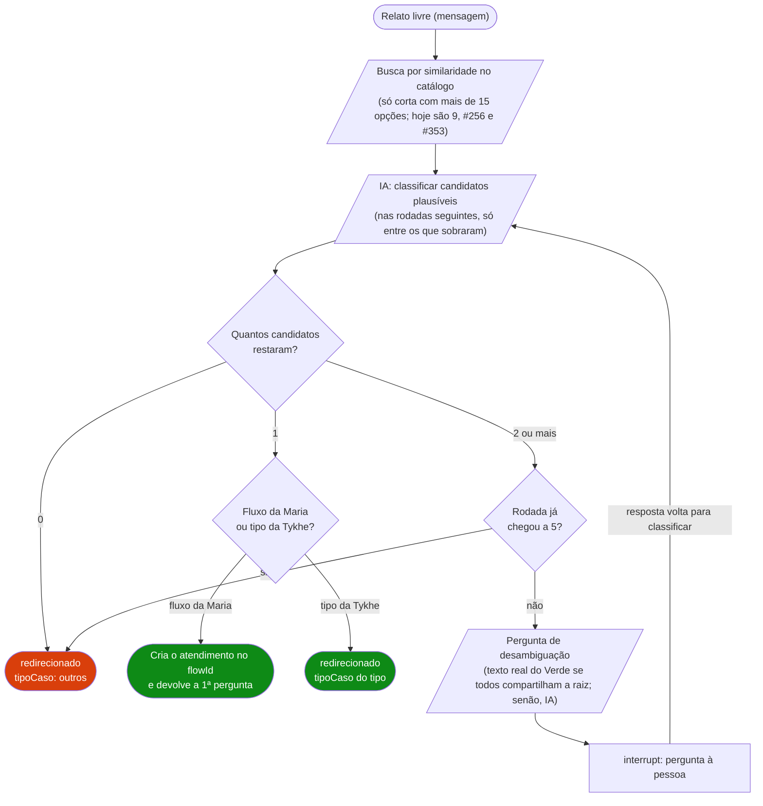

# Fluxo: orquestrador (classificação automática)

Alternativa a `POST /atendimentos` pra quem **não sabe de antemão** qual `flowId` usar: manda um relato livre (`mensagem`) e a Maria classifica com IA qual fluxo atende o caso, criando o atendimento normalmente nele.

Grafo próprio (`src/maria/orquestrador/graph.py`), rota HTTP dedicada (`POST /atendimentos/orquestrador`, `src/maria/api/orquestrador.py`).

Usa 4 dos 6 módulos de `src/maria/ia/` (`classificar`, `classificar_fluxos`, `desambiguar`, `sumarizar`) — **só o orquestrador chama esses 4**, nenhum fluxo de negócio (`src/maria/fluxos/<fluxo>/graph.py`) usa. Os outros 2 módulos (`reescrever`, `extrair`) são o inverso: usados por fluxos, nunca pelo orquestrador. Sem sobreposição — ver `docs/ia.md` pro que cada módulo faz.

> O diagrama em PNG publicado no S3 (`orquestrador.png`) é de antes do #242 e desenha o relato não identificado como `handoff_humano`. Até ele ser republicado, vale este (achado C1 da spec 09; ver #249).

## Passo a passo

1. **`classificar`** — 1ª rodada: busca por similaridade (embedding, `fluxo_embeddings`) no catálogo de classificação (`catalogo_para_classificacao()`: 2 fluxos implementados + 7 tipos atendidos pela Tykhe, issue #225; os planejados só entram com `ORQUESTRADOR_INCLUIR_PLANEJADOS=true`), retorna até 15 candidatos (`CANDIDATOS_MAXIMOS`; era 10 até a #353, que mediu o ganho com as 74 categorias ligadas fora do ar). **Com o catálogo de 9 opções, a busca não corta nada:** com até 15 opções, o catálogo inteiro passa sem calcular embedding nenhum (#256). Chama IA (`classificar_fluxos_plausiveis`) pra filtrar quais desses candidatos são plausíveis de verdade a partir do relato. Rodadas seguintes: classifica de novo, mas só **dentro** do subconjunto que já sobrou — nunca alarga de volta pro catálogo todo.
2. Decisão por quantos candidatos restaram (`depois_de_classificar`):
   - **0** → `nenhum` → nó `naoIdentificado` → `redirecionado` com `tipoCaso: "outros"` (issue #225; antes era `handoff_humano`).
   - **1** → `um` → nó `identificado` → segue pra criar o atendimento nesse `flowId`.
   - **2+** → `muitos` → precisa desambiguar (próximo passo) — **a menos que já tenha esgotado `LIMITE_RODADAS` (5)**, aí também cai em `nenhum` → `redirecionado`/`outros` (nunca fica perguntando pra sempre).
3. **`prepararPerguntaDesambiguacao`** — antes de gerar pergunta por IA, checa se **todos** os candidatos restantes compartilham literalmente a mesma pergunta raiz do Verde (mesmo texto + mesmas opções, `buscar_pergunta_real_compartilhada`) — se sim, usa esse texto real (não gasta token de IA). Senão, gera pergunta por IA (`gerar_pergunta_desambiguacao`).
4. **`pedirDesambiguacao`** — `interrupt()` pausa esperando a resposta da pessoa (`tipoResposta: "texto"` sempre — decisão deliberada: mostrar nomes internos dos candidatos como menu soava técnico, deixa responder com as próprias palavras). Resposta é concatenada no relato bruto (`mensagem`, auditoria completa) e volta pro `classificar`.
5. A partir da 3ª rodada (`LIMITE_RODADAS_SUMARIZACAO`), o histórico vira resumo por IA (`sumarizar_relato`) + última resposta verbatim — evita mandar um relato bruto gigante pra classificação/desambiguação depois de várias idas e vindas.
6. Quando identifica um **tipo da Tykhe** (`src/maria/fluxos/tipos_tykhe.py`): não cria atendimento; responde `status: "redirecionado"` + `tipoCaso` e a Tykhe continua (issue #225). Log: `orquestrador_redirecionado` com `tipoCaso`.
7. Quando identifica 1 fluxo: `buscar_fluxo(flowIdEscolhido)` resolve pro grafo implementado de verdade OU pro grafo padrão (fluxo planejado sem implementação própria ainda) — dali em diante o tratamento é idêntico nos 2 casos. O total de tokens gastos na triagem (classificação + desambiguação) é repassado como ponto de partida do acumulador do fluxo escolhido (`dadosConhecidos.tokensGastos`) — não perde o custo da fase de identificação.

## Regras de negócio

| Regra | Valor | Por quê |
|---|---|---|
| Candidatos por rodada de retrieval | 10 | Mesmo valor de antes da issue #28. |
| Limite de rodadas de desambiguação | 5 | Subiu de 3 (issue #43) — com 76 categorias no catálogo (na época), relatos ambíguos entre categorias parecidas levam mais idas e vindas pra convergir. |
| Rodada em que começa a sumarizar | 3 | Issue #47 — histórico bruto cresce demais depois de algumas rodadas. |
| `candidatosRestantes` nunca alarga de volta | — | Cada rodada de classificação só filtra dentro do que já sobrou, nunca reconsidera candidato já descartado. |
| Pergunta usa texto real do Verde quando possível | — | Issue #32 — só quando **todos** os candidatos restantes compartilham a mesma pergunta raiz (mesmo texto + mesmas opções); senão, gera por IA. |
| `tipoResposta` sempre `"texto"` na desambiguação | — | Decisão 2026-09-11 — nomes internos de categoria como menu de opção soava técnico pro usuário real. |

## Tipos atendidos pela Tykhe (issue #225)

| `tipoCaso` | Menu da Tykhe |
|---|---|
| `saude` | Questões de saúde |
| `novo-processo` | Iniciar um novo processo |
| `andamento-processo` | Ver andamento do processo |
| `agendamentos` | Ver meus agendamentos |
| `ajuda-app` | Ajuda APP Defensoria RJ |
| `outros` | Outros (também o destino de relato não identificado) |
| `sair` | Sair |

Pessoa presa e violência doméstica continuam conduzidos pela Maria. Descrições usadas na classificação: `src/maria/fluxos/tipos_tykhe.py`. No bridge do WhatsApp (sem Tykhe por trás), `redirecionado` encerra a conversa com uma orientação fixa (aplicativo Defensoria RJ ou 129).

## Contrato HTTP (resumo — ver `docs/contrato-tykhe.md` pro genérico)

- 1ª chamada: `{ chatId, mensagem }`.
- Enquanto desambiguando (`status: em_andamento` sem `flowId`): manda `{ chatId, resposta }` pra essa mesma rota (não `mensagem`).
- Quando resolve: `flowId` aparece na resposta e o atendimento já foi criado nesse fluxo — dali em diante é `GET`/`POST /atendimentos/respostas` normais, como qualquer atendimento criado direto.
- Checkpoint do orquestrador usa `thread_id` com prefixo (`orquestrador:${chatId}`) — namespace separado do fluxo final escolhido (que usa o `chatId` puro), pra não colidir os 2 grafos no mesmo `thread_id`.
