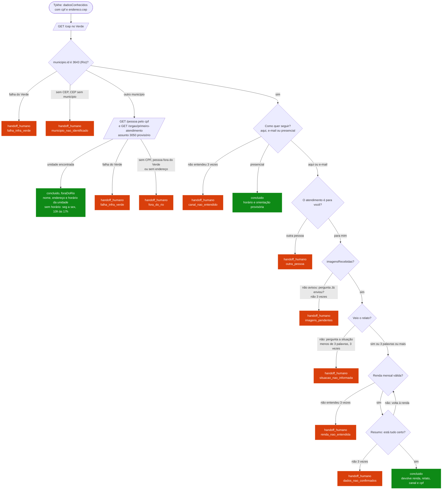

# Fluxo: Problemas com plano de saúde (NUDECON)

`flowId`: `84433c84-4776-4b05-a5a0-af8012d8eced` (`problemas-plano-de-saude`) — código em `src/maria/fluxos/plano_saude/`. Issues: #329 (fluxo), #331 (fora do Rio), #354 (roteiro de testes).

Quem teve negativa do plano de saúde (cirurgia, exame, tratamento, reembolso) e mora no município do Rio de Janeiro. É um fluxo de urgência: **toda falha encerra com atendimento humano**, porque a pessoa pode precisar do serviço para marcar uma cirurgia de emergência.

O diagrama mostra o estado de 2026-10-29. Qualquer exceção inesperada em qualquer nó também encerra com `handoff_humano` (`erro_interno`), e por isso não está desenhada. Faltam: o relato do orquestrador (#334), os dados de outra pessoa (#347), o encaminhamento ao NUDECON pelo Verde (#265) e o e-mail com as imagens (#345).

## Entrada

`POST /atendimentos` com `flowId` e `dadosConhecidos`:

| Campo | Para quê |
|---|---|
| `endereco.cep` | Confere o município. **Sem CEP o atendimento vai ao humano.** |
| `cpf` | Só no ramo fora do Rio: acha a pessoa no Verde e, por ela, a unidade. |
| `nome`, `dataNascimento`, `email`, `telefone`, `endereco` | Aparecem no resumo; ausente ou vazio vale "não informado". |
| `imagensRecebidas` | A Tykhe avisa que guardou as imagens (#336). Sem o aviso, a Maria pergunta "Já enviou?". |
| `relato` | Vem do orquestrador (#334). Sem ele, a Maria pergunta a situação. |

## Passo a passo

1. **Município.** `GET /cep` do Verde com o CEP. `municipio.id` igual a 3643 (Rio): segue. Outro município: ramo fora do Rio. CEP sem município ou não encontrado: `municipio_nao_identificado`. Verde fora: `falha_infra_verde`.
2. **Canal.** "Por aqui, por e-mail ou presencialmente?" Presencial conclui com o horário. Três respostas sem entender: `canal_nao_entendido`.
3. **Para quem.** Outra pessoa: `outra_pessoa`.
4. **Imagens.** Sem `imagensRecebidas`, pergunta "Já enviou?". Três "não": `imagens_pendentes`.
5. **Situação.** Só sem relato. Mínimo de 3 palavras; três respostas curtas: `situacao_nao_informada`.
6. **Renda.** Número em reais (0 vale). Três respostas sem número: `renda_nao_entendida`.
7. **Resumo.** "Está tudo certo?" Não volta à renda; três "não": `dados_nao_confirmados`. Sim conclui.

### Fora do Rio

A Maria busca a pessoa pelo CPF (`GET /pessoa`) e consulta `GET /orgao/primeiro-atendimento` com `ID_ASSUNTO_UNIDADE_FORA_DO_RIO` (3050, provisório). A unidade vem do **endereço cadastrado no Verde**, e não do CEP enviado. Com unidade, conclui com nome, endereço e horário (sem horário no Verde, vale "de segunda a sexta, das 10h às 17h", também provisório). Sem unidade, vai ao humano.

## Desfechos

| `status` | `motivoHandoff` | Quando |
|---|---|---|
| `concluido` | — | Resumo confirmado, ou presencial |
| `concluido` | — (`metadados.foraDoRio: true`) | Fora do Rio com unidade indicada |
| `handoff_humano` | `fora_do_rio` | Fora do Rio sem unidade: sem CPF, pessoa fora do Verde, lista vazia ou órgão sem endereço |
| `handoff_humano` | `municipio_nao_identificado` | Sem CEP, CEP não encontrado ou sem município no Verde |
| `handoff_humano` | `falha_infra_verde` | Verde falhou (401, 403, 5xx) na conferência do município ou na busca da unidade (#376) |
| `handoff_humano` | `erro_interno` | Exceção inesperada em qualquer nó (#375); o log leva só o nome do nó e o tipo do erro |
| `handoff_humano` | `canal_nao_entendido`, `outra_pessoa`, `imagens_pendentes`, `situacao_nao_informada`, `renda_nao_entendida`, `dados_nao_confirmados` | Os passos acima |

Todo `handoff_humano` sai com `destino: atendimento_humano`. Falha fora do fluxo (banco, checkpointer, erro da própria API) não é coberta: continua 500.

## O que a Tykhe recebe

`metadados`: `canal`, `paraSi`, `relato`, `renda`, `foraDoRio` e `motivoHandoff`, quando existem. `dadosColetados` só leva o `cpf`. **`concluido` não basta**: o presencial e o fora do Rio também concluem, e a Tykhe diferencia pelo `metadados.canal` e pelo `metadados.foraDoRio`.

## LGPD

CPF, nome, endereço, relato e renda nunca vão para log: só `chatId` e `fluxoId`.
