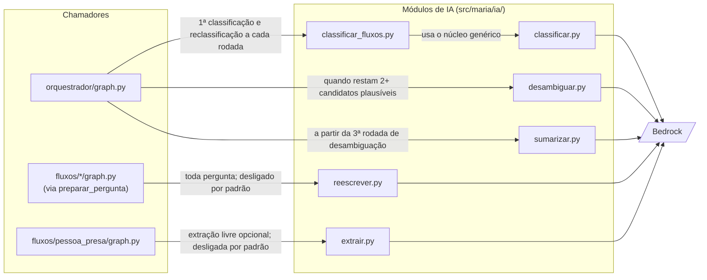
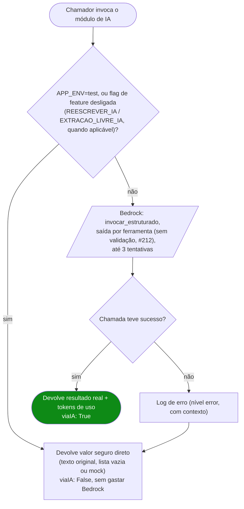

# IA (`src/maria/ia/`)

Toda chamada de IA (Bedrock) do sistema mora aqui — 6 módulos, cada um resolvendo 1 problema específico, mais o núcleo comum `_estruturado.py`. Nenhum fluxo (`src/maria/fluxos/<fluxo>/graph.py`) ou o orquestrador chama o Bedrock direto; todos passam por um destes.

## Visão de conjunto — quem chama qual módulo

> Os diagramas em PNG publicados no S3 (`mapa-modulos-ia.png` e `padrao-comum-ia.png`) desenham os arquivos e as variáveis da versão TypeScript. Até serem republicados, valem estes (spec 09, D-4).

## Padrão comum a todos os módulos

- **Modelo**: `ChatBedrockConverse` (langchain-aws), via `BEDROCK_MODEL_ID` (padrão `anthropic.claude-3-haiku-20240307-v1:0`; produção usa `us.anthropic.claude-haiku-4-5-20251001-v1:0`) e `AWS_REGION` (padrão `us-east-1`). Uma instância por módulo, criada na importação (`criar_modelo()` em `_estruturado.py`).
- **Saída estruturada** (`invocar_estruturado`): reproduz o `withStructuredOutput` da versão TypeScript, **sem validar** a saída do modelo — a ausência de validação é defeito herdado, mantido de propósito até a decisão da #212. Por isso não se troca por `with_structured_output` com classe Pydantic (ver [`src/maria/ia/CLAUDE.md`](../src/maria/ia/CLAUDE.md)).
- **Retry**: 3 tentativas (`TENTATIVAS_RETRY_IA`) antes de desistir — absorve instabilidade passageira do Bedrock (throttle, timeout de rede), não mascara erro real. Falha de parse não dispara retry; só erro do modelo.
- **Fallback nunca quebra o fluxo**: se a chamada falhar mesmo depois do retry, cada módulo cai num valor seguro (texto original, lista vazia, `None`) — a pergunta/fluxo continua funcionando, só sem o benefício da IA naquela vez. Nunca propaga a exceção pro chamador.
- **`viaIA`** no retorno de todos — `True` só quando a chamada de IA aconteceu de verdade; `False` cobre tanto "não chamou" (modo mock/flag desligada) quanto "chamou e falhou". Tokens (`tokensEntrada`/`tokensSaida`/`tokensTotal`) só vêm preenchidos quando `viaIA` é `True` — capturados do `usage_metadata` da `AIMessage` crua.
- **Mock em teste**: `APP_ENV=test` pula a chamada real em todo módulo — suíte rápida, sem custo, sem variabilidade de resposta de LLM quebrando assert de texto fixo.
- **Embeddings** (busca por similaridade do orquestrador) ficam em `src/maria/shared/embeddings_fluxos.py`, com o retry em duas camadas herdado da versão TypeScript (#222): com o Bedrock fora, a busca leva de 8 a 17 minutos para desistir.

## Os 6 módulos

### `classificar.py`

Núcleo reaproveitável: "texto livre + lista de candidatos rotulados → candidato(s) escolhido(s) via IA". Duas funções:
- `classificar_entre_opcoes` — força 1 escolha só (ou nada, se nada bater com confiança).
- `classificar_multiplo_entre_opcoes` — devolve **todos** os candidatos plausíveis (0, 1 ou vários) — usado quando o chamador precisa saber se o relato é ambíguo, não só qual é o melhor.

Cada chamador mantém seu próprio guard de teste/mock — este módulo só faz a chamada quando invocado, não decide isso.

### `classificar_fluxos.py`

Usa `classificar_multiplo_entre_opcoes` pra montar o prompt específico de "escolher fluxo de atendimento a partir do catálogo" — chamado pelo orquestrador (`src/maria/orquestrador/graph.py`). Mock em teste: `MOCK_CLASSIFICACAO_FLOWIDS` (lista separada por vírgula, testa ambiguidade) ou `MOCK_CLASSIFICACAO_FLOWID` (singular, 1 id só).

### `desambiguar.py`

Gera o **texto** de 1 pergunta que ajuda a distinguir entre candidatos ambíguos — as opções em si (nome de cada fluxo) são montadas deterministicamente pelo chamador, nunca pela IA (evita inventar opção que não existe no catálogo). Fallback: `"Pra te ajudar melhor, qual dessas opções descreve o que você precisa?"`.

### `extrair.py`

Extrai campos estruturados (`temProcesso`, `numeroProcesso`, `rg`, `parentesco`) de texto livre — regra explícita no prompt: nunca inferir além do que foi dito. Só roda com `EXTRACAO_LIVRE_IA=true` **e** fora de teste (desligada por padrão) — usada na extração livre opcional do fluxo pessoa presa.

### `reescrever.py`

Reescreve o **texto** de uma pergunta pra ficar mais natural, sem mudar o que é perguntado (campo/ordem continuam determinísticos no grafo). Só roda com `REESCREVER_IA=true` **e** fora de teste — **desligada por padrão desde 2026-08-31**, decisão explícita depois de ver fraseado estranho em produção real (ex: "Essa é o Fulano presa?"). Também expõe `preparar_pergunta()`, helper usado por todos os fluxos no padrão de 2 nós "preparar" (chama IA 1x) + "pedir" (só lê o texto pronto e pausa em `interrupt()`) — separar em 2 nós evita gastar Bedrock de novo a cada resume (gotcha do LangGraph: código antes do `interrupt()` no mesmo nó reexecuta a cada retomada).

### `sumarizar.py`

Resume o relato acumulado do orquestrador quando a desambiguação passa de um limite de rodadas (ver [`docs/fluxo-orquestrador.md`](fluxo-orquestrador.md)) — evita reenviar histórico bruto crescente em toda chamada seguinte. Se falhar, mantém o texto original (nunca perde contexto por causa de falha de resumo). Mock em teste: `MOCK_SUMARIZACAO_RESUMO` simula uma compressão de verdade (sem ele, o texto original é devolvido sem encolher).

## Flags de ambiente

| Flag | Default | Efeito |
|---|---|---|
| `BEDROCK_MODEL_ID` | `anthropic.claude-3-haiku-20240307-v1:0` | Modelo usado por todos os módulos. |
| `AWS_REGION` | `us-east-1` | Região do Bedrock. |
| `REESCREVER_IA` | desligada | Reescrita de texto de pergunta — desligada por decisão de produto. |
| `EXTRACAO_LIVRE_IA` | desligada | Extração de campos por IA no fluxo pessoa presa. |

A lista completa de variáveis está no [`README.md`](../README.md). Ver [`src/maria/ia/CLAUDE.md`](../src/maria/ia/CLAUDE.md) pras regras que não podem falhar (nunca logar dado sensível indo pro Bedrock, nunca remover o caminho mock).
